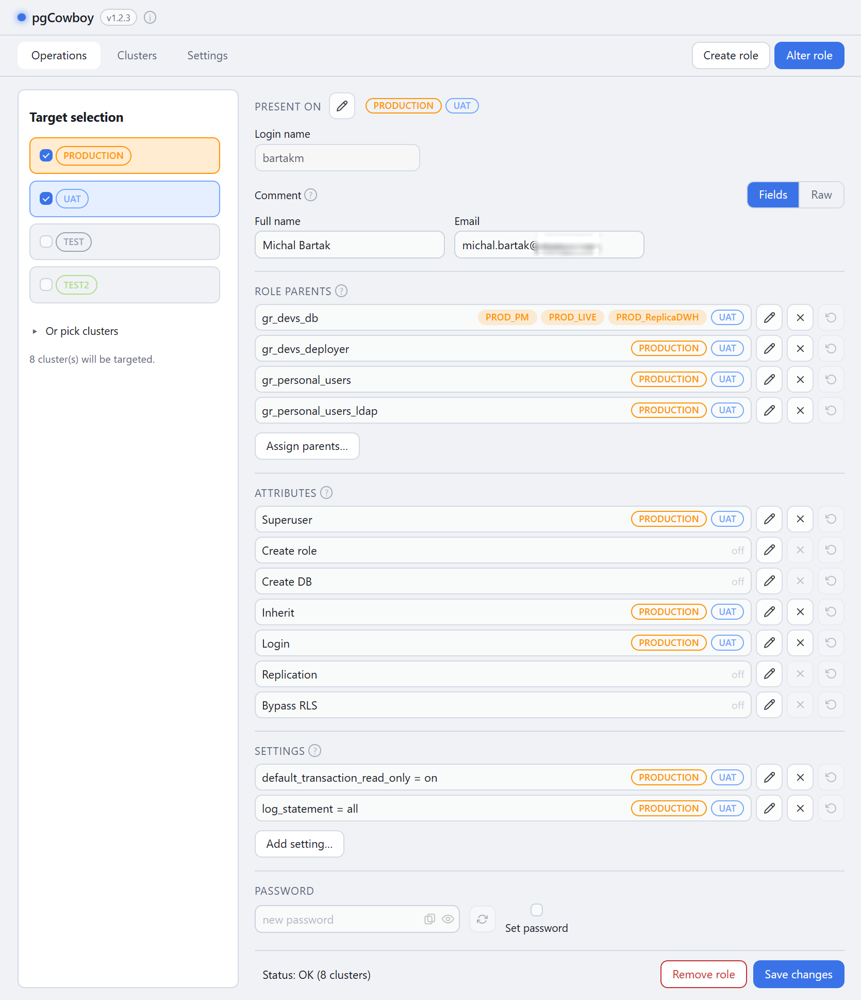

# pgCowboy

A cross-platform desktop app for maintaining **PostgreSQL roles across many clusters**. Create and alter roles on all your selected clusters from one form, through SQL call templates you can read and edit. Built with Go, Wails v2, and pgx.

## Quick start

Download from the [Releases page](../../releases)

Runs on: macOS 12+, Windows 10+, or Linux, see [System requirements](https://michal-bartak.github.io/pgcowboy/installation/#system-requirements).

📖 **[Full documentation](https://michal-bartak.github.io/pgcowboy/)**

## License

[MIT](./LICENSE) © 2026 Michal Bartak.
